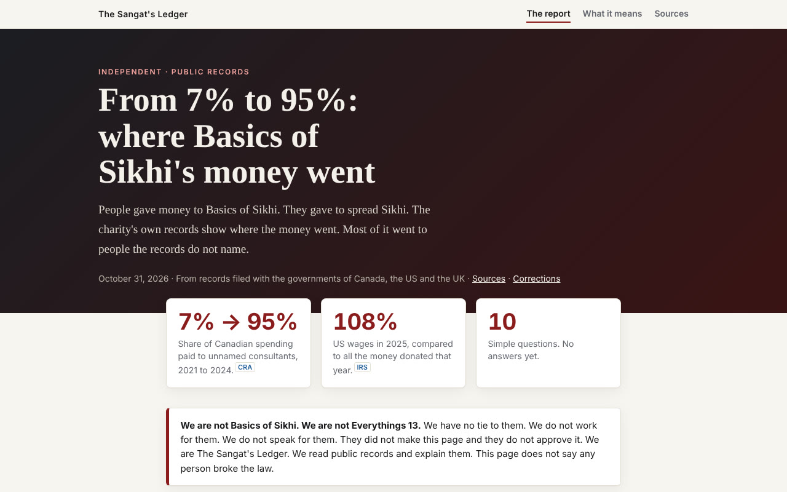
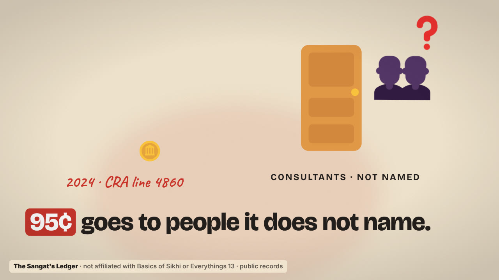

# The Sangat's Ledger

### Where does $1 given to Basics of Sikhi go? The charities' own public filings, in plain words.

**[▶ Read the report](https://thesangatsledger.github.io/basicsofsikhi/)** &nbsp;·&nbsp;
**[What it means](https://thesangatsledger.github.io/basicsofsikhi/implications.html)** &nbsp;·&nbsp;
**[One-minute explainer](https://thesangatsledger.github.io/basicsofsikhi/explainer.html)** &nbsp;·&nbsp;
**[Portrait reel](https://thesangatsledger.github.io/basicsofsikhi/reel.html)**

> **We are not Basics of Sikhi. We are not Everythings 13. We have no affiliation with them.** They did not make or approve this report. Every number comes from records the charities filed with their governments. Nothing here says any person committed fraud, theft or any crime. It asks questions the filings raise.

## The short version

| | What the public filings show |
|---|---|
| 🇨🇦 **Canada** | Unnamed "professional and consulting fees" went from **7%** of spending (2021) to **79%**, **88%**, then **95%** (2024: C$97,021 of C$102,334). The charity stopped reporting what it spent on programs in 2021. |
| 🇺🇸 **United States** | In 2025, Everythings 13 paid **$130,794** in wages against **$120,559** in donations (108%), with officers' pay listed at $0. In 2024, $230,172 of $230,176 was recorded as "government grants." |
| 💸 **Dasvandh Network** | Reported a $39,580 grant (2023) to "EVERYTHINGS13-BASICS OF SIKHI" under a tax ID that is not in the IRS master file. |
| 🇬🇧 **United Kingdom** | Income £623,030 (2025). Fundraising costs up 83% since 2023, while income rose 6%. |

**[Read the full report, with a source link on every number →](https://thesangatsledger.github.io/basicsofsikhi/)**

## Watch it in a minute

- **[Landscape explainer](https://thesangatsledger.github.io/basicsofsikhi/explainer.html)**: plays in the browser, no sound needed.
- **[Portrait reel](https://thesangatsledger.github.io/basicsofsikhi/reel.html)** for phones and Instagram. Download the video: **[where-does-1-go-reel.mp4](https://thesangatsledger.github.io/basicsofsikhi/assets/reel/where-does-1-go-reel.mp4)**.

## Check it yourself

| Charity | Registration | Where to look |
|---|---|---|
| Basics of Sikhi Society (Canada) | BN 752991695RR0001 | [CRA List of Charities](https://apps.cra-arc.gc.ca/ebci/hacc/srch/pub/dsplyRprtngPrd?q.srchNm=&q.stts=0007&selectedCharityBn=752991695RR0001&dsrdPg=1) |
| Everythings 13 (US) | EIN 32-0647672 | [ProPublica Nonprofit Explorer](https://projects.propublica.org/nonprofits/organizations/320647672) |
| Everythings 13 (UK) | Charity 1143262 | [Charity Commission register](https://register-of-charities.charitycommission.gov.uk/en/charity-search/-/charity-details/5019738/financial-history) |

Every figure, with its source, in one file: **[figures.csv](https://thesangatsledger.github.io/basicsofsikhi/data/figures.csv)**. The full source list is at the bottom of the **[report](https://thesangatsledger.github.io/basicsofsikhi/#sources)**.

## Right of reply and corrections

Basics of Sikhi Society, Everythings 13 and Dasvandh Network are invited to respond. Responses will be published in full and unedited at the top of the report. Corrections from anyone are welcome, with a source: **sangatledger@gmail.com**. Past corrections are listed in the **[corrections log](https://thesangatsledger.github.io/basicsofsikhi/#corrections)**.

## Credits

- Illustrations: [Microsoft Fluent Emoji](https://github.com/microsoft/fluentui-emoji), MIT License.
- Explainer animation rig adapted from [Bang Motion](https://github.com/bangtutorial/bang-motion), MIT License.
- Fonts: Bricolage Grotesque and Caveat, SIL Open Font License 1.1.
- Libraries: React, ReactDOM, htm (MIT) and GSAP (GSAP Standard License).
- Reel voiceover: AI-generated with [Kokoro-82M](https://github.com/hexgrad/kokoro) (Apache-2.0), voice "af_heart".
